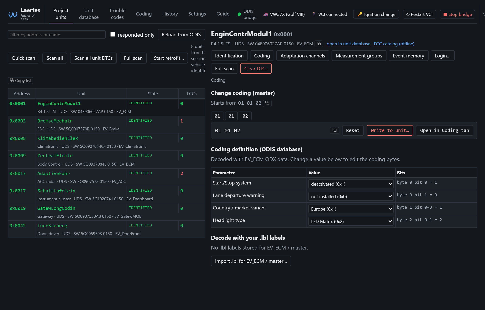

# Laertes — father of Odis

A web front end for ODIS diagnostics. A small macro running inside ODIS (the bridge) exposes the
unit functions over a local socket; `laertes.exe` serves a web page that uses it to identify units,
read and write coding and adaptations (each write read back and verified), watch measurement values
live, read fault memory with repair guidance, flash firmware or datasets, browse the ODIS database offline and keep a history of
every change. The **Help** tab in the web page explains setup and every tab, button and option.

*Project units with a control unit selected: its coding decoded against the ODIS database into
editable options. (The data shown is illustrative.)*

## Contents

| Path | What it is |
|---|---|
| `laertes.exe` (built) | Web server and UI (Go, single file, SQLite database `laertes.db` next to it) |
| `mcpserver.py` | Bridge macro: TCP server run from the ODIS macro function |
| `mcpserver_handlers.py` | Bridge actions, reloaded by the macro whenever the file changes |
| `index.html` | The web page, embedded into `laertes.exe` |
| `scripts/licenses.sh` | Generates `THIRD_PARTY_LICENSES.txt` for a release |
| `scripts/devbridge.py` | Development connection to the bridge (blocks Laertes while open) |

## Build

Double-click `build.cmd` (needs [Go](https://go.dev/dl/)) — it runs the tests and builds
`laertes.exe`. The two bridge scripts are embedded in it: on every start it copies them to
`C:\ProgramData\OE\macros\` when they are missing or differ, and, if the bridge is not running and ODIS
is not open with its window, starts ODIS in the background as its automation web service and runs
`mcpserver.py` there (`executeMacro`). For use without a VCI it also embeds an offline VCI, a
hardware-less J2534 device built from `offlinevci/offlinevci.c` (the DLL is committed; rebuild it with
`offlinevci\build.cmd`, which needs [zig](https://ziglang.org)).

By default Laertes serves a stand-in for VW's online services on `127.0.0.1:23032` (account
`admin`/`admin`): VW's online (GRP) sign-in, and VW's GSB web service at `/services` (the online
call behind component protection, PinService `ProcessPin`). While it runs, the bridge points ODIS's
GSB URLs (`url.*.gsb`) at it before each online guided function, so a function such as component
protection completes its online step offline; the virtual VCI then accepts whatever it writes to the
units. (Component protection's GSB call carries no token, so no sign-in happens; a flow that needs
sign-in is served on the same port once ODIS's `grp.discovery` points there.) Run `laertes.exe
-grpstub=false` to use VW's real backend instead.

To send bridge actions by hand while Laertes is running, use the development connection on
`127.0.0.1:18766`: `python scripts/devbridge.py '{"action": "ping"}'` (several commands as further
arguments, or one per line on stdin). While it is connected the bridge refuses Laertes's commands with
"development connection active", so the two never drive ODIS at once; Laertes works again as soon as
the script exits. `"token": "@"` in a command stands for the debug token (for `_debug`). A command
that hangs inside ODIS keeps the connection busy even after the script exits; `{"action": "shutdown"}`
still gets through then and stops the bridge, and Laertes starts it again.

## Release

Pushing a tag `vX.Y.Z` runs the release workflow (`.gitea/workflows/release.yml` on Gitea,
`.github/workflows/release.yml` on GitHub): it checks that the tag matches `version`
in `main.go`, runs the tests, builds `laertes.exe` and publishes a release with the executable, the
two bridge scripts, `LICENSE` and `THIRD_PARTY_LICENSES.txt`.

## License

Laertes is released under the [MIT License](LICENSE).

`laertes.exe` includes the Go runtime and these modules, all under permissive licenses (BSD-3-Clause,
MIT or ISC): `github.com/coder/websocket`, `modernc.org/sqlite`, `modernc.org/libc`, `modernc.org/mathutil`, `modernc.org/memory`,
`golang.org/x/sys`, `github.com/remyoudompheng/bigfft`, `github.com/dustin/go-humanize`,
`github.com/mattn/go-isatty`, `github.com/ncruces/go-strftime`. Their notices are shipped with every
release in `THIRD_PARTY_LICENSES.txt`. The repository contains no third-party data files.

## Disclaimer

- Laertes is an independent project. It is **not affiliated with, endorsed by or supported by**
  Volkswagen AG, its brands, or Ross-Tech LLC. ODIS is a product of Volkswagen AG; VCDS is a product of
  Ross-Tech LLC; all trademarks belong to their owners.
- Laertes contains **no ODIS software, ODIS data or ODX/diagnostic data**. It works only with a copy
  of ODIS you have installed and are licensed to use, through ODIS's own macro function. You are
  responsible for complying with the license terms of your ODIS installation and of any data you use
  (for example label files).
- Coding, adaptation and security-access functions change control units. Use them at your own risk,
  on vehicles or test benches you are authorised to work on. The software is provided "as is", without
  warranty of any kind (see the license).
